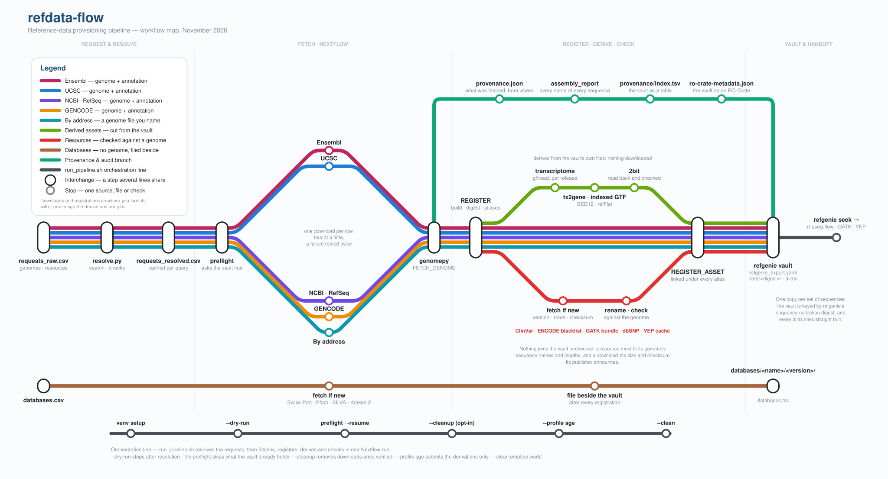

# refdata-flow: Project Walkthrough

A tour of how the pipeline is put together, for someone about to run it or change it. The README is the full reference; this is the short version, with pointers into it.



## 1. Four stages, one command

`run_pipeline.sh` runs all of it:

1. **Resolve (`bin/resolve.py`)**: turns the generic queries in `requests/requests_raw.csv` (`GRCh38`, `mouse`) into exact assemblies, asking you when a query matches more than one. It checks the rows before anything downloads: an annotation asked for where none is published, two rows that are one download, one alias on two genomes. The answers are cached per query in `requests/requests_resolved.csv`.
2. **Fetch (Nextflow, `FETCH_GENOME`)**: a preflight (`PREFLIGHT`) reads the vault first and marks each request `SKIP` or `FETCH`. Only what the vault lacks is downloaded through genomepy, four at a time, each failure retried twice. Every download writes a `provenance.json`.
3. **Register (`REGISTER`, `bin/update_refgenie.py`)**: in the same Nextflow run, refgenie files each genome under a digest of its sequences, with a sequence dictionary beside the FASTA, tags each annotation with its release, and links your aliases.
4. **Derive and check**: a transcriptome (`DERIVE_TXOME`) and the small files pipelines ask for (`DERIVE_ANNOTATION`, `DERIVE_TWOBIT`) are made from what the vault holds. Third-party resources named in the `resources` column are fetched (`FETCH_RESOURCE`), renamed if they must be and checked against their genome (`PREPARE_RESOURCE`), and only then registered (`REGISTER_ASSET`). Databases listed in `requests/databases.csv` are fetched (`FETCH_DATABASE`) and filed beside the vault (`FILE_DATABASE`).

## 2. What the digest is, and is not

refgenie 0.13 computes a sequence-collection digest over each FASTA record's name, length and sequence, in file order, and stores the genome under it in `data/<digest>/`. The same sequences give the same digest, so two requests for one genome share one copy.

It covers the FASTA only: the annotation is identified by its release tag and the checksums in the download record. And it is refgenie's own digest, related to the GA4GH refget standard without conforming to it: it uses a legacy encoding and does not uppercase the sequence first. Treat it as a reliable identifier for the sequences in this vault, not as a portable fingerprint. The README's *refgenie vault layout* has the detail.

Your aliases (`human`, `mm39`) are links per file, each straight to the digest directory and renamed to the alias, so a tool sees `human.fa`.

## 3. Storage

- **Nothing is fetched twice.** The preflight asks the vault, so a re-run does not depend on Nextflow's `work/` surviving.
- **Downloads are kept.** `--cleanup` removes one only after its contents are verified in the vault, and copies `provenance.json`, `README.txt` and `assembly_report.txt` to `<outdir>/provenance/` first. It is opt-in because a provider's old release cannot always be fetched again.
- **The vault's FASTA is uncompressed**, because refgenie decompresses it to index it. Budget for that.
- **Every fetch checks the free space first.** A large resource is held up to three times until `work/` is cleaned; for dbSNP that is about 90 GB.

## 4. Dry-run verification

Before downloading anything large, `--dry-run` resolves the requests, writes the cache, and stops:

```text
$ bash run_pipeline.sh --dry-run
...
[Step 1] Running interactive reference resolver...

--- 'GRCh38' for Homo_sapiens already resolved to GRCh38.p14. Skipping search. ---
--- 'mouse' for Mus_musculus already resolved to GRCm39. Skipping search. ---
--- 'sacCer3' for Saccharomyces_cerevisiae already resolved to sacCer3. Skipping search. ---

Resolved 3 request(s). Written to requests/requests_resolved.csv.

==========================================
  DRY RUN COMPLETE
  The following datasets would be downloaded:
==========================================
  - Homo_sapiens: GRCh38.p14 (Provider: Ensembl, Annotations: TRUE, Release: 116)
  - Mus_musculus: GRCm39 (Provider: Ensembl, Annotations: TRUE, Release: current)
  - Saccharomyces_cerevisiae: sacCer3 (Provider: UCSC, Annotations: TRUE, Release: current)
==========================================
  Exiting without downloading.
```

The list is what was resolved, not what will be fetched: the preflight, which runs only in a real run, skips whatever the vault already holds.

## 5. Clearing Nextflow's files

`--clean` deletes `work/`, `.nextflow/` and the Nextflow logs, and nothing else:

```text
$ bash run_pipeline.sh --clean
Cleaning up Nextflow cache, logs, and work directories...
Clean complete! Storage optimized.
```

The vault is untouched. What goes is the resume cache (a download that finished but was not yet registered) and the conda environment Nextflow built, which the next run builds again.

## 6. HPC configuration

### The REFGENIE variable

To let the `refgenie` CLI find the vault without `-c` on every command, set `REFGENIE`. Any tool built on `refgenconf` reads it too. nf-core pipelines do not: they take reference paths as parameters, so pass them the paths `refgenie seek` prints.

1. **Find the config**: `refgenie_export.yaml` in your `--outdir`, for example `/shared/reference_datasets/refgenie_export.yaml`.
2. **Add it to your profile**:
   ```bash
   echo "export REFGENIE=/shared/reference_datasets/refgenie_export.yaml" >> ~/.bashrc
   ```
3. **Apply it**:
   ```bash
   source ~/.bashrc
   ```
4. **Check it**:
   ```bash
   refgenie list
   ```
   This lists every genome with its aliases, from any directory.

> [!TIP]
> **System-wide modules:** with an environment module system such as Lmod, add `setenv REFGENIE /path/to/refgenie_export.yaml` to a shared module file, so everyone inherits the vault with `module load`.

### The SGE profile

`--profile sge` submits the derivations as cluster jobs and keeps everything that needs the network, or edits the vault's config, on the machine you launched from. It is set up for the UCL clusters and has been checked to load, but has not yet submitted a job to a real scheduler. See the README's *Running on an SGE cluster*.

## 7. The documents, and how to rebuild them

The documents are generated, so each has one source to edit. The generators live in `docs/`, which is not tracked by git.

| Output | Source | Rebuild |
|---|---|---|
| `refdata-flow_User_Guide.docx` | `docs/build_user_guide.js` | `cd docs && npm run guide` |
| `refdata-flow deck.html`, and in `docs/` the default, light and dark `.pptx` decks and their two image-only versions | `docs/deck_content.js` (the words and speaker notes), drawn by `docs/build_deck.js` and `docs/deck.css` | `cd docs && npm run deck` |
| `refdata-flow_map.svg` and `.png` | `docs/build_map.py` | `cd docs && npm run map` |

You need [Node.js](https://nodejs.org/), and `npm install` in `docs/` once. The deck and the map are rendered on Windows: the image-only decks are exported by PowerPoint, and the map's PNG by Microsoft Edge. `npm run deck:pptx` builds the editable decks and the HTML deck without PowerPoint.

The HTML deck runs in a browser: arrow keys move, `N` shows the speaker notes, `T` switches between the three themes, `P` prints.
